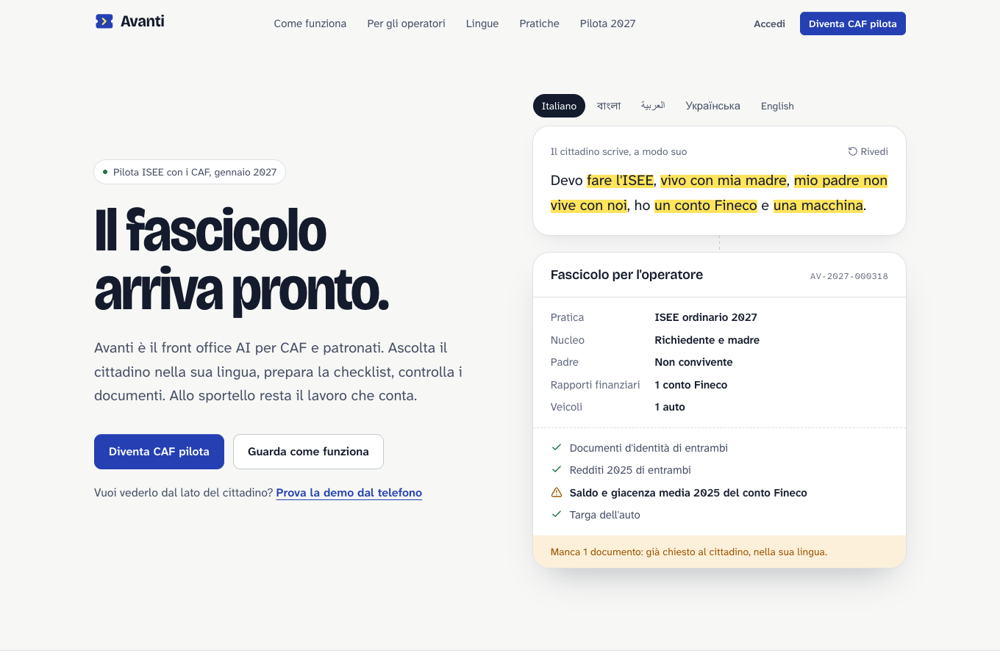
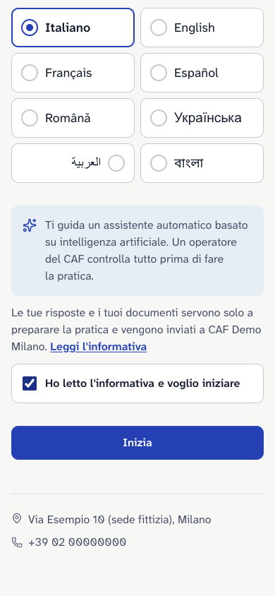
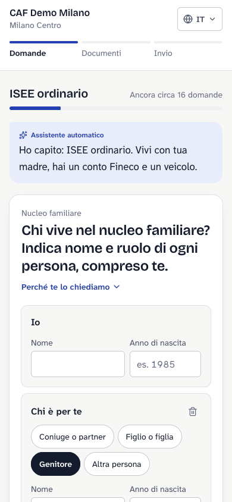
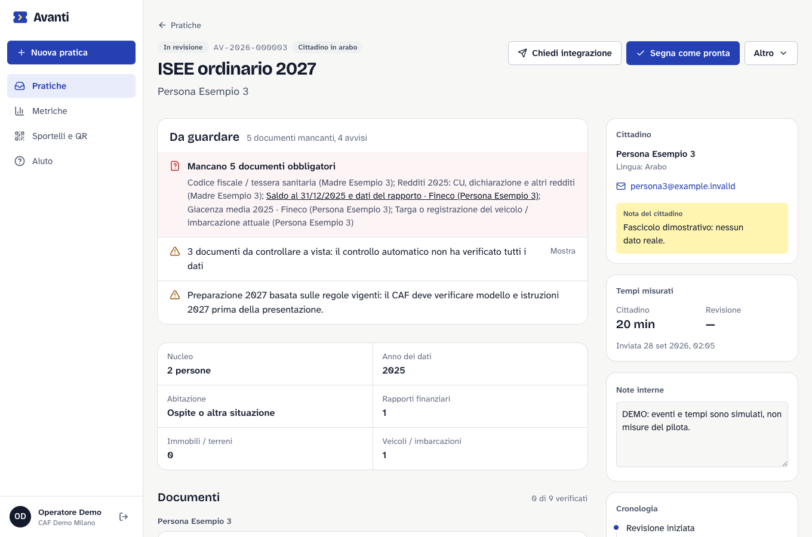

# Avanti

**Il fascicolo arriva pronto. Avanti il prossimo.**

Avanti è il front office AI per CAF e patronati. Il cittadino descrive in parole sue (e nella
sua lingua) cosa deve fare; Avanti capisce la pratica, fa solo le domande necessarie, costruisce
la checklist personalizzata, controlla i documenti caricati e consegna all'operatore un
fascicolo ordinato, con quello che manca già evidenziato.

Avanti **non** sostituisce l'operatore abilitato né il gestionale del CAF: prepara il lavoro
prima che arrivi allo sportello.

```
cittadino → AI → fascicolo completo → operatore CAF → pratica ufficiale
```

> Stato: in sviluppo attivo, pronto per le prove interne. Primo verticale: **ISEE ordinario
> 2027** (DSU con redditi e patrimoni 2025), pilota con CAF gennaio 2027. Vedi la
> [roadmap](docs/ROADMAP.md).



| Cittadino: ingresso dal QR                           | Cittadino: una domanda alla volta                  | Cittadino: documenti                                   |
| ---------------------------------------------------- | -------------------------------------------------- | ------------------------------------------------------ |
|  |  |  |



Gli screenshot si rigenerano con `pnpm --filter @avanti/web screenshots` (dati demo fittizi).

## Avvio rapido

```bash
pnpm install        # store globale ~/Library/pnpm/store (.npmrc)
pnpm dev            # http://localhost:3400
```

Requisiti: Node ≥ 22.19 (consigliato 24), pnpm 10. Nessuna chiave necessaria in locale.

## Percorsi dell'app

| Percorso                 | Per chi   | Cosa fa                                                       |
| ------------------------ | --------- | ------------------------------------------------------------- |
| `/`                      | CAF       | Landing e candidatura al pilota                               |
| `/s/[sportello]`         | Cittadino | Ingresso dal QR dello sportello: lingua, informativa, avvio   |
| `/pratica/[token]`       | Cittadino | Esigenza, domande, documenti, invio (link personale)          |
| `/console`               | Operatore | Coda pratiche con filtri                                      |
| `/console/pratiche/[id]` | Operatore | Fascicolo: problemi, verifica documenti, integrazioni, export |
| `/console/metriche`      | Operatore | Tempi e completezza misurati                                  |
| `/console/sportelli`     | Operatore | Link e QR degli sportelli, cartello A4 da stampare            |

## Struttura

| Percorso             | Cosa contiene                                            |
| -------------------- | -------------------------------------------------------- |
| `apps/web`           | Next.js 16: landing, flusso cittadino, console operatore |
| `packages/contracts` | Schemi zod condivisi delle API                           |
| `packages/core`      | Catalogo pratiche, intervista, checklist, verifiche      |
| `packages/db`        | Schema Drizzle, migrazioni, seed                         |
| `packages/api`       | Backend Hono montato su `/api`                           |
| `docs/`              | Architettura, API, modello dati, ricerca normativa       |

## Script

| Comando                              | Effetto                                                                          |
| ------------------------------------ | -------------------------------------------------------------------------------- |
| `pnpm dev`                           | Avvia l'app web con backend integrato                                            |
| `pnpm check`                         | Lint + typecheck + test di tutti i pacchetti                                     |
| `pnpm --filter @avanti/web test:e2e` | Test end-to-end Playwright e controlli axe (WCAG 2.2 AA, temi chiaro/scuro, RTL) |
| `pnpm build`                         | Build di produzione                                                              |
| `pnpm db:check`                      | Verifica Postgres reale, migrazioni e indici senza modifiche                     |
| `pnpm preflight`                     | Verifica configurazione produzione, senza connessioni o segreti nei log          |
| `pnpm admin:bootstrap`               | Crea il primo CAF/admin con conferma, solo da terminale amministrativo           |
| `pnpm admin:export`                  | Esporta il CAF in JSON, solo admin autenticato da CLI                            |
| `pnpm db:seed`                       | Carica i dati demo                                                               |

## Documentazione

- [Stato e roadmap](docs/ROADMAP.md)
- [Architettura](docs/ARCHITECTURE.md)
- [Design e UX](docs/DESIGN.md)
- [Guida per gli operatori](docs/guide/operatori.md)
- [Ricerca: mercato, competitor, normativa](docs/research/README.md)
- [Istruzioni per agenti e contributori](AGENTS.md)

## Sviluppo backend

```bash
pnpm install
pnpm db:seed      # idempotente, solo demo: mai su un database con dati reali
pnpm dev          # http://localhost:3400
curl http://localhost:3400/api/health
pnpm format:check
pnpm check
pnpm build
```

Se il watcher nel sandbox macOS restituisce `EMFILE`, lo smoke locale può usare
`WATCHPACK_POLLING=1000 pnpm dev --env-mode=loose -- --port=3417`.
La modalità `loose` passa l’impostazione di polling al processo Next; la porta diversa
consente di mantenere avviato l’altro worktree.

Il database locale (PGlite in `.data/pglite`) ammette un solo processo alla volta: non
lanciare `pnpm db:*` mentre `pnpm dev` è attivo sulla stessa cartella e ferma il server con
Ctrl+C. Se all'avvio compare `RuntimeError: abort` da PGlite, il database demo è
danneggiato: `rm -rf .data && pnpm db:migrate && pnpm db:seed` lo ricrea (solo dati demo).

Il seed crea **CAF Demo Milano**, sedi `demo-milano-centro` e
`demo-milano-loreto`, dieci fascicoli e PDF chiaramente marcati ESEMPIO. Le
metriche demo sono sintetiche, non risultati del pilota. Credenziali locali:

| Ruolo       | Email                           | Password          |
| ----------- | ------------------------------- | ----------------- |
| Admin       | `admin@demo.avanti.local`       | `DemoAvanti2027!` |
| Operatore   | `operatore@demo.avanti.local`   | `DemoAvanti2027!` |
| Disattivato | `disattivato@demo.avanti.local` | accesso negato    |

La password è identica soltanto nei dati demo. Seed rifiutato con
`NODE_ENV=production`, Vercel o `DATABASE_URL` configurata; non distribuire queste credenziali in ambienti reali. I link
cittadino vengono mostrati una volta alla creazione; non sono ricostruibili dal DB.

## Avvio di un CAF pilota

La procedura in [DEPLOY.md](docs/DEPLOY.md) prepara Neon UE, Blob privato, backup e
variabili. `pnpm preflight` è read-only e restituisce exit 1 per errori obbligatori;
`pnpm preflight --local` ammette i fallback solo fuori produzione. Il build Vercel
lo esegue prima delle migrazioni. Dopo migrazioni e check, usare
`NODE_ENV=production pnpm admin:bootstrap` in terminale privato: conferma esplicita,
password temporanea mostrata una volta e cambio obbligatorio. Il seed demo è vietato.
Per uscire dal pilota: `NODE_ENV=production pnpm admin:export`, con admin del CAF,
produce JSON riservato in `.data/exports` con risposte, eventi e hash dei documenti;
i file binari vanno trasferiti separatamente. Backup e prove trimestrali nel runbook.

## Configurazione

Copia `.env.example` in `apps/web/.env.local` per Next. Gli script DB leggono
variabili della shell: per Postgres esporta `DATABASE_URL` quando esegui
`pnpm db:migrate` e gli altri comandi amministrativi. Il seed accetta solo PGlite locale.

| Variabile                           | Effetto                                                                                                         |
| ----------------------------------- | --------------------------------------------------------------------------------------------------------------- |
| `DATABASE_URL`                      | Postgres con postgres-js; vuota: PGlite in `.data/pglite`                                                       |
| `BLOB_READ_WRITE_TOKEN`             | Vercel Blob privato; vuota: disco `.data/uploads`                                                               |
| `AI_GATEWAY_PROVIDER`               | Provider Gateway unico consentito (default `anthropic`); se non disponibile, fallback locale                    |
| `AI_GATEWAY_API_KEY`                | Abilita AI SDK 7; vuota: flusso euristico senza chiamate esterne                                                |
| `AI_MODEL_TEXT` / `AI_MODEL_VISION` | ID Gateway `provider/model`, default `anthropic/claude-sonnet-5.5`                                              |
| `PUBLIC_APP_URL`                    | Origine aggiuntiva per CSRF e base dei link; obbligatoria in produzione, default locale `http://localhost:3400` |
| `TRUST_PROXY`                       | `1` con proxy fidato: IP dell’ultimo hop di x-forwarded-for; su Vercel x-real-ip                                |

`RATE_LIMIT_SECRET` è obbligatorio in produzione: segreto casuale stabile per gli
HMAC dei bucket IP/email. In locale, senza un indirizzo di trasporto attendibile,
il login usa il limite per email e i turni/upload quello per link cittadino.
I proxy devono fornire l’header fidato; gli header client non sono usati quando
`TRUST_PROXY=0`.

`MFA_ENCRYPTION_KEY` è obbligatoria in produzione (32 byte casuali in 64 cifre hex,
diversa da cron/rate limit). In locale la chiave di cifratura TOTP viene creata in
`.data/mfa-encryption.key`, con permessi 0600. La demo resta senza MFA. Flussi e
contratti in [API.md](docs/API.md), gestione in [guida operatori](docs/guide/operatori.md).

Il cookie è una sessione opaca casuale salvata come hash; non necessita di un segreto
di firma condiviso. I parametri per organizzazione sono in `settings`: baseline
manuale, durata link 60 giorni, retention 180 giorni. Il job cron applica la retention a lotti di 25 fascicoli; procedura, scheduler e prove
di cancellazione nel deployment sono prerequisiti del pilota.

Migrazioni SQL versionate in `packages/db/migrations`, generate con `pnpm db:generate`.
Applicate idempotentemente all'avvio in sviluppo/test. In produzione eseguire
`pnpm db:migrate` prima del rilascio. Su Vercel sono obbligatori Postgres e Blob
privato: il filesystem serverless non è uno storage persistente. La configurazione
Next include migrazioni e font nell'output tracing ed esclude PGlite dal bundle.

L'analisi euristica usa indizi del nome file e del formato: non attesta leggibilità,
titolarità o completezza. L'operatore deve verificare. Senza AI, le richieste libere
dell'operatore mantengono l'originale italiano e mostrano un avviso localizzato; non
vengono presentate come traduzioni già verificate.

## Limiti per la sala d'attesa

La capability identifica la pratica; l'IP fidato è un tetto condiviso ampio, non
l'identità del cittadino. I bucket sono persistiti come HMAC, distinti per categoria
e finestra. I controlli della pratica/email precedono quelli IP: richieste già bloccate
per quell'identità non consumano il budget del Wi-Fi.

| Operazione              | Identità principale                                                  | Tetto IP fidato e burst        |
| ----------------------- | -------------------------------------------------------------------- | ------------------------------ |
| Nuova pratica pubblica  | Non esiste ancora una capability                                     | 60/ora, burst 40/minuto        |
| Turni intervista        | 400/ora e 60/minuto per capability                                   | 15.000/ora, burst 1.500/minuto |
| Upload                  | 120/ora e 30/minuto per capability; 4 simultanei per pratica/istanza | 4.000/ora, burst 400/minuto    |
| Login/cambio password   | 10/minuto per email; cambio anche per operatore                      | 100/minuto                     |
| Export operatore        | 20/minuto per operatore                                              | 200/minuto                     |
| Rigenerazione link      | 20/minuto per operatore, bucket distinto dagli export                | 200/minuto                     |
| Traduzioni/integrazioni | 30/minuto per operatore                                              | 300/minuto                     |
| Candidature CAF         | —                                                                    | 5/minuto                       |

Sono finestre fisse che partono dalla prima richiesta, con guardia al minuto per i
burst; non un token bucket a ricarica continua. Ogni tentativo arrivato a un bucket
lo consuma anche se un controllo successivo rifiuta la richiesta. Un 429 contiene
`rate_limited`, attesa reale in `Retry-After` e messaggio nella lingua della pratica
(o dell'avvio validato; italiano per login). Upload simultanei: invito ad attendere
fine caricamento e riprovare dopo 5 secondi, senza garanzia che siano già finiti.
In locale senza IP attendibile restano i limiti capability/email.
La suite `waiting-room.test.ts` verifica 40 avvii simultanei e interviste complete
sotto 10 minuti dallo stesso IP, oltre a 10 operatori che accedono con un retry.

## Documentazione backend

- [API e semantica dei KPI](docs/API.md)
- [Modello dati](docs/DATA_MODEL.md)
- [Sicurezza e prerequisiti GDPR/AI Act](docs/SECURITY.md)
- [Deploy e avvio CAF pilota: preflight, bootstrap, backup ed export](docs/DEPLOY.md)
- [Ricerca ISEE 2027 e limiti annuali](docs/research/isee-2027.md)
- [Decisioni backend](docs/decisions/backend.md)

ISEE e 730 2027 sono preparati secondo le regole disponibili al 5–6 ottobre 2026:
modelli e istruzioni annuali vanno ricontrollati prima del pilota. Avanti prepara
un fascicolo e non trasmette alcuna pratica agli enti.

Le sessioni si rinnovano anche durante la consultazione: 30 minuti di inattività e massimo 12 ore. Al cambio password il cookie viene ruotato e le sessioni precedenti revocate.
La manutenzione è separata dalle richieste utente: `GET /api/cron/maintenance`, con
`Authorization: Bearer <CRON_SECRET>`, elimina sessioni e bucket scaduti, cancella i fascicoli oltre retention e ritenta le
cancellazioni dei file. La pianificazione è in `apps/web/vercel.json` (Root Directory Vercel `apps/web`):
`0 3 * * *`, giornaliero UTC, compatibile con Hobby. Per Pro si può scegliere
`* * * * *` nel file prima del rilascio. Le letture autorizzate di un fascicolo
recuperano in background le analisi ferme oltre 2 minuti, sotto lease DB condiviso
con upload e cron. Hobby resta soggetto alle condizioni d’uso del piano. Vercel invoca solo Production: lo staging
usa un progetto separato con dati fittizi; le Preview richiedono una chiamata manuale
o uno scheduler esterno. La cadenza recupera fino a quattro analisi ferme da oltre due
minuti per run e applica retention/retry a lotti. Configurazione, costi e prove in
[DEPLOY.md](docs/DEPLOY.md).
`CRON_SECRET` deve essere casuale e riservato; senza segreto l’endpoint rifiuta ogni chiamata.
La manutenzione limita i tentativi a uno al minuto anche dopo un errore. Le cancellazioni
fallite restano in `storage_deletions` fino alla conferma dello storage.

I download e gli export appendono eventi di accesso anche su GET; la lettura di un
fascicolo non modifica la sua data di aggiornamento o lo stato di revisione.
Ogni pratica accetta al massimo 60 documenti e 120 MiB complessivi, con 4 MiB per file. Il parser PDF usa un worker riutilizzabile,
un heap dimensionato sul limite upload e una scadenza di 15 secondi per lavoro. Timeout,
OOM e saturazione restituiscono 503 con invito a riprovare; un PDF non leggibile restituisce 415.
HEIC resta scaricabile e soggetto a controllo visivo dell’operatore.

In produzione l’adattatore Fetch di Next richiede un proxy fidato. Con un server Node
che passa i binding Hono, inizializzare `createApp({ ..., transport: "node" })` prima di
aprire il listener: il rate limit usa `incoming.socket.remoteAddress`. Un adattatore diverso
può fornire `clientAddress`. La configurazione priva di un trasporto identificabile o proxy
viene rifiutata all’inizializzazione, con un errore esplicito. Non fidarsi di header inviati
direttamente dal client.

`GET /api/health` espone `fallbackCount`, il numero di errori AI degradati al fallback
nella singola istanza, senza dettagli di richieste o cittadini.

## Licenza

Proprietario. Tutti i diritti riservati.

L’upload Next restituisce `processing` prima dell’analisi AI, eseguita con `after()`.
La manutenzione recupera documenti rimasti in analisi e upload interrotti, tracciati
con un lease di cancellazione prima del put. La migrazione 0007 aggiunge il lease di analisi. Le migrazioni pilota 0005/0006 aggiungono
indici e `pg_trgm`, incluso anche nei test PGlite. Prove, misure e integrazione web
in [pilot-hardening.md](docs/verification/pilot-hardening.md).
